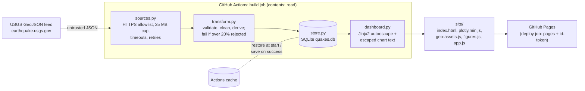

# QuakeWatch

QuakeWatch is an automated earthquake data pipeline. Every six hours, a GitHub Actions workflow:

1. fetches the [USGS earthquake GeoJSON feed](https://earthquake.usgs.gov/earthquakes/feed/v1.0/geojson.php),
2. validates and cleans it,
3. stores it in SQLite, keeping history beyond the 30 days USGS publishes,
4. publishes an interactive dashboard to GitHub Pages as a static site.

Security is a first-class requirement. All upstream data is treated as untrusted, the published page runs under a strict Content-Security-Policy and makes no third-party requests, and CI uses least-privilege tokens, SHA-pinned actions, hash-pinned dependencies and no secrets. The threat model and the requirement-by-requirement mapping are in [SECURITY.md](SECURITY.md).

> **Screenshot:** _placeholder. Add `docs/screenshot.png` after the first live deploy._

## Architecture



| Module | Responsibility |
| --- | --- |
| [`quakewatch/sources.py`](quakewatch/sources.py) | `usgs`: live feed, allowlisted and size-capped. `sample`: a deterministic offline fixture with dirty and hostile rows. |
| [`quakewatch/transform.py`](quakewatch/transform.py) | GeoJSON to DataFrame, drop reasons, `region` and `mag_class`, the quality report and the 20% rule. |
| [`quakewatch/store.py`](quakewatch/store.py) | SQLite schema, idempotent upserts, the `runs` log, the time index. All SQL is parameterized. |
| [`quakewatch/dashboard.py`](quakewatch/dashboard.py) | Header stats plus three Plotly charts, written as a static site that works under the CSP. |
| [`quakewatch/pipeline.py`](quakewatch/pipeline.py) | The CLI. Wires the steps together, logs each run, exits non-zero on any failure. |

### Why the site is several files, not one

The page is `index.html` plus four local scripts rather than a single self-contained HTML file. The CSP is `script-src 'self'`, which forbids inline `<script>`, so:

- Plotly's figure JSON lives in `figures.js` and the render code in `app.js`.
- `plotly.min.js` is copied from the pinned `plotly` wheel, not loaded from a CDN.
- The world map outlines (`geo-assets.js`) are vendored. Without them, plotly.js would fetch them from `cdn.plot.ly` at runtime, which `connect-src 'none'` blocks.

## Running locally

Requires Python 3.12. [uv](https://docs.astral.sh/uv/) is an easy way to get it: `uv python install 3.12`.

```bash
python3.12 -m venv .venv && source .venv/bin/activate
```

```bash
pip install --require-hashes -r requirements-dev.txt
```

Run the offline pipeline on the bundled sample data:

```bash
python -m quakewatch --source sample --window month --db data/quakes.db --out site
```

Serve the result over HTTP so it behaves as it does on Pages:

```bash
python -m http.server 8000 --bind 127.0.0.1 --directory site
```

Then open <http://127.0.0.1:8000>. For live data, use `--source usgs` (needs network access).

| Option | Values | Default |
| --- | --- | --- |
| `--source` | `usgs` (live), `sample` (offline fixture) | `usgs` |
| `--window` | `day`, `week`, `month` (which USGS summary feed to fetch) | `day` |
| `--db` | path to the SQLite file; must not be inside `--out` | `data/quakes.db` |
| `--out` | site output directory | `site` |

The exit code is `0` on success. It is `1` when the fetch fails, the feed is malformed, every row is rejected, more than 20% of rows are rejected, or `--db` is inside `--out`. In each of those cases nothing is published.

### Checks

These all run offline except `pip-audit`, which queries the vulnerability database:

```bash
pytest -q
```

```bash
ruff check . && ruff format --check .
```

```bash
bandit -r quakewatch
```

```bash
pip-audit --strict --disable-pip --require-hashes -r requirements.txt -r requirements-dev.txt
```

Pre-commit hooks (ruff, gitleaks, detect-private-key): `pre-commit install`.

## Validation rules

Each feature is either accepted or counted under exactly one drop reason. The counts appear in the logs, in the `runs` table and in the dashboard header.

| Reason | Rule |
| --- | --- |
| `malformed_feature` | the feature, `properties` or `geometry` is not an object |
| `missing_field` | `id`, `time`, `mag`, `place` or coordinates missing, or empty after cleaning |
| `invalid_type` | non-string id/place; non-finite or non-numeric time, magnitude or coordinates (booleans, NaN and Infinity included) |
| `magnitude_out_of_range` | magnitude outside [-2, 10] |
| `latitude_out_of_range` / `longitude_out_of_range` | outside [-90, 90] / [-180, 180] |
| `time_out_of_range` | before 1970 or after 2100 |
| `duplicate_id` | an id already accepted in this feed (the first one wins) |

Strings are cleaned on ingest: control characters and Unicode bidi overrides are stripped, whitespace is collapsed, `place` is capped at 200 characters and `id` at 64. The run fails if nothing is accepted, which covers an empty feed, or if more than 20% of rows are rejected, which usually means the upstream format changed. Derived columns:

- `region` is the text after the last comma in `place`.
- `mag_class` follows the USGS classes: micro, minor, light, moderate, strong, major, great.

## Deploying to GitHub Pages

1. Push the repository to GitHub with `main` as the default branch.
2. **Settings → Pages → Build and deployment → Source: GitHub Actions.**
3. **Actions → Publish dashboard → Run workflow.** The first run finds no cached history, so it fetches the 30-day `month` feed. After that, the [schedule](.github/workflows/pages.yml) (every 6 hours) fetches the `week` feed, which overlaps generously.
4. The site appears at `https://<user>.github.io/quakewatch/`.

The publish workflow only runs in `hponukumati/quakewatch`, never in forks. If you fork or rename the repo, change the `if:` guard in `pages.yml` and `tests/test_workflows.py`. Then apply the GitHub settings listed in [SECURITY.md](SECURITY.md#recommended-github-settings).

## Keeping history beyond 30 days

USGS summary feeds cover 30 days at most. To keep longer history, the publish job restores `data/quakes.db` from the **GitHub Actions cache** at the start of each run and saves a new cache entry **only after the run succeeds**.

Why the cache rather than the alternatives:

| Option | Trade-off |
| --- | --- |
| **Actions cache (chosen)** | Needs no extra token permission, so the build job stays at `contents: read` and no job can write to the repository. Caches are not publicly downloadable. Caches created by pull requests are scoped to the PR and can't be restored on `main`. Saving only on success means a failed run never replaces good history. |
| `data` branch | Durable and auditable, but needs a job holding `contents: write`, and it commits a changing binary SQLite file to git history on every run (repository bloat). |
| Workflow artifact | Retention is at most 90 days, artifacts in a public repository are downloadable by anyone, and restoring across runs needs `actions: read`. |

**The accepted risk:** GitHub evicts a cache entry that goes unused for 7 days, or when a repository passes 10 GB of cache. The 6-hourly schedule keeps the entry in use. If it is evicted, the next run reseeds from the 30-day feed, and history older than that is lost. The dashboard keeps working throughout. A restored database is treated as untrusted (see [SECURITY.md](SECURITY.md)).

## Updating dependencies

Dependabot opens weekly PRs for Python packages and GitHub Actions. To update by hand:

```bash
pip-compile --generate-hashes --allow-unsafe --strip-extras --output-file=requirements.txt requirements.in
```

```bash
pip-compile --generate-hashes --allow-unsafe --strip-extras --output-file=requirements-dev.txt requirements-dev.in
```

When `plotly` changes, regenerate the sample site and check the map in a browser. The bundled plotly.js version changes with it, and plotly.js 4 already changed one default (see `fitbounds` in `dashboard.py`).

## Alternative: self-hosting (not the default)

GitHub Pages is the supported target. If you host the site yourself, publish only the static `site/` folder and keep the pipeline separate.

**Web server.** Caddy gives automatic HTTPS. Send these headers. Unlike the `<meta>` CSP, real headers can also carry `frame-ancestors`, HSTS and `X-Frame-Options`:

```caddyfile
quakes.example.com {
    root * /srv/quakewatch/site
    file_server
    @notget not method GET HEAD
    respond @notget 405
    header {
        Strict-Transport-Security "max-age=63072000; includeSubDomains"
        Content-Security-Policy "default-src 'none'; script-src 'self'; style-src 'self' 'unsafe-inline'; img-src 'self' data:; connect-src 'none'; base-uri 'none'; form-action 'none'; frame-ancestors 'none'"
        X-Content-Type-Options "nosniff"
        Referrer-Policy "no-referrer"
        Permissions-Policy "camera=(), microphone=(), geolocation=(), payment=(), usb=(), interest-cohort=()"
        X-Frame-Options "DENY"
        -Server
    }
}
```

- **Permissions-Policy:** an empty header value would restrict nothing. Giving each powerful feature an empty allowlist `()` turns it off.
- **Rate limiting:** standard Caddy has none. Build Caddy with the [`caddy-ratelimit`](https://github.com/mholt/caddy-ratelimit) plugin, or use nginx, whose `limit_req` is built in: `limit_req_zone $binary_remote_addr zone=perip:10m rate=10r/s;` with `limit_req zone=perip burst=20 nodelay;`. With nginx, get certificates with certbot and add the same headers using `add_header ... always`.

**Container (optional).**
- Use an unprivileged static server image pinned by digest. Look the digest up yourself with `docker buildx imagetools inspect nginxinc/nginx-unprivileged:<tag>`. Never use a floating tag.
- Run it with `--read-only --cap-drop ALL --security-opt no-new-privileges --user 101:101`, add `--tmpfs` for the server's cache and pid directories, and mount `site/` read-only.
- Publish only the proxy port.

**Pipeline.**
- Run `python -m quakewatch` as a separate scheduled job (a systemd timer or cron) under its own user with no inbound access.
- Write into a staging directory and swap it into place only when the exit code is 0.
- No application server is ever exposed.

## Project layout

```
quakewatch/            package (sources, transform, store, dashboard, pipeline)
  templates/           Jinja2 page template (autoescaped)
  static/app.js        chart render code (external, CSP-safe)
  assets/              vendored world_110m topojson (SHA-256 pinned)
tests/                 pytest suite, fully offline
.github/workflows/     ci.yml (tests, audit, lint, secrets) and pages.yml (scheduled publish)
requirements*.in/.txt  direct deps and hash-pinned lock files
```
