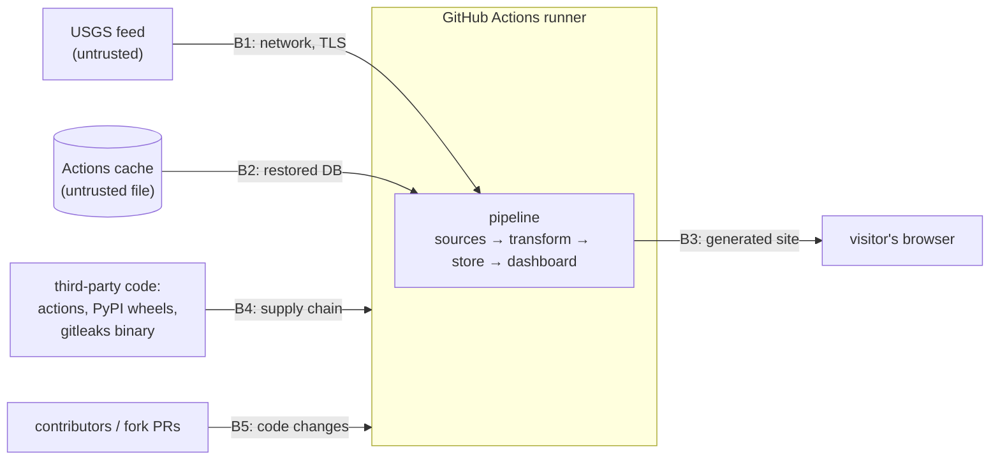

# Security

QuakeWatch publishes a public website from data it does not control, on a schedule, using repository credentials. This document covers:

- [reporting a vulnerability](#reporting-a-vulnerability)
- [findings and fixes](#findings-and-fixes) from the initial review
- the [threat model](#threat-model)
- where each mitigation is [implemented and tested](#mitigations-mapped-to-requirements)
- the [residual risks](#residual-risks)
- the [GitHub settings](#recommended-github-settings) the maintainer must apply by hand

## Reporting a vulnerability

Please report vulnerabilities privately through **GitHub private vulnerability reporting**: open the repository's **Security** tab and choose **Report a vulnerability**. Do not open a public issue for a security problem.

This is a personal portfolio project, maintained on a best-effort basis. Expect an acknowledgement within 7 days. Credit is given in the fix commit unless you prefer otherwise.

## Findings and fixes

Initial review, 2026-11-15. The brief asked for any existing code to be reviewed before changes. The repository was empty: it had no commits, no `quakewatch/` package, no `tests/` and no workflows. So there was nothing to patch, and the system was built against the brief. The table records that and the problems found while building it.

| # | Finding | Fix | Where |
| --- | --- | --- | --- |
| 1 | Repository was empty; no code, tests or CI to review. | Built from scratch against the brief; every requirement is mapped below. | (whole repo) |
| 2 | **Known issue from the brief:** the dashboard header built HTML with an f-string and inserted feed `place` text unescaped (stored XSS). No such code existed here. | Prevented by design: the page is a Jinja2 template with `autoescape=True`, and Plotly text goes through one `html.escape` choke point. Regression tests send `` and `">` through the full pipeline. | `quakewatch/dashboard.py:46`, `:50`; `tests/test_pipeline.py::test_hostile_feed_strings_render_inert` |
| 3 | plotly.js fetches map outlines from `cdn.plot.ly` at runtime: a third-party request, blocked by `connect-src 'none'`. | Vendored `world_110m.json`, pinned by SHA-256, and preloaded into `window.PlotlyGeoAssets` from a local script. | `quakewatch/dashboard.py:40`, `:231` |
| 4 | Plotly's standard HTML output uses an inline `<script>`, which `script-src 'self'` blocks. | Figure JSON goes to `figures.js` and render code to `app.js`; the page has zero inline scripts. | `quakewatch/dashboard.py:80`; `quakewatch/static/app.js` |
| 5 | Plotly hover text decodes `&lt; &gt; &amp;` but shows `&quot;` literally. | Chart text uses `html.escape(quote=False)`. This is safe because `<` is always escaped, so no tag or attribute can form. The page template still escapes quotes. | `quakewatch/dashboard.py:57` |
| 6 | A huge `updated` value from the feed would overflow SQLite's INTEGER and crash the run (denial of service by data). | `updated` is bounded like `time`; out-of-range values fall back to the event time. | `quakewatch/transform.py:132`; `tests/test_transform.py::test_out_of_range_updated_falls_back_to_time` |
| 7 | `gitleaks-action` needs `GITHUB_TOKEN` (and a license for organizations), which conflicts with "no secrets". | CI downloads the gitleaks release binary pinned by version and SHA-256 and runs it directly. | `.github/workflows/ci.yml:64-81` |
| 8 | Bandit B613 (Trojan Source) flagged bidi escape sequences in source. | Bidi code points are written as numbers, so the source contains none; no `# nosec`. | `quakewatch/transform.py:36` |
| 9 | Functional: plotly.js 4 defaults `geo.fitbounds` to `"locations"`, which throws for scattergeo, and the map failed to draw. | `fitbounds=False`. | `quakewatch/dashboard.py:217` |
| 10 | Usability: geo charts zoom on the scroll wheel, hijacking page scroll. | `scrollZoom: false`. | `quakewatch/static/app.js:8` |
| 11 | Process: the settings checklist required one pull request approval, which a sole maintainer can never give, so `main` would be locked. Found while setting up the ruleset, 2026-11-16. | 0 approvals while there is one maintainer; every change still needs a pull request and green CI. | [Recommended GitHub settings](#recommended-github-settings), item 2 |

## Threat model

### Assets

1. **Integrity of the published site.** Visitors' browsers run it. This is the asset that matters most.
2. **The repository and its CI credentials.** These are the per-job `GITHUB_TOKEN` and the Pages OIDC token; misused, they could push code or deface the site.
3. **Stored history.** `quakes.db` lives in the Actions cache; its integrity and availability matter.
4. **Visitor privacy.** No tracking, and no requests that reveal visits to third parties.
5. **The maintainer's GitHub account.**

### Trust boundaries

| Boundary | What crosses it | Treated as |
| --- | --- | --- |
| B1 USGS → pipeline | JSON over HTTPS | Untrusted: allowlisted, size-capped, shape-checked, validated, cleaned, escaped on output |
| B2 cache → pipeline | a SQLite file written by an earlier run | Untrusted: `trusted_schema=OFF`, and everything rendered from it is escaped |
| B3 pipeline → browser | HTML/JS we generate | Must be inert: strict CSP, no inline script, escaped data, no third-party requests |
| B4 third-party code → CI | actions, Python packages, gitleaks | Pinned by commit SHA, hash or checksum; minimal token permissions |
| B5 contributors → CI | pull requests | `pull_request` only (read-only token, no secrets); merging gated by branch protection |

### Attacker goals

- **Stored XSS through feed text**, from a compromised or spoofed upstream: run script in visitors' browsers or deface the site.
- **Abusing the fetcher:** redirect it to another host (SSRF-style), exhaust memory with a huge or gzip-bomb response, or crash it with malformed JSON, NaN, deep nesting or huge integers.
- **SQL injection** through feed ids.
- **Abusing CI:** steal or misuse the token to push code or publish a malicious site; slip in a compromised action or package through a mutable tag or unpinned dependency.
- **Accidental disclosure:** publish secrets, the database or logs.
- **Silent corruption:** an upstream format change producing an empty or bogus dashboard.
- **Tracking visitors** through third-party requests.

## Mitigations mapped to requirements

Line numbers are as of the initial commit series.

### 1. Untrusted data and XSS

| Requirement | Implementation | Test |
| --- | --- | --- |
| Escape all feed strings in generated HTML (header, tiles, hover text) | The page is rendered by Jinja2 with `autoescape=True`. Plotly text goes through `escape_text()`. | `tests/test_dashboard.py::test_hostile_strings_are_escaped_everywhere` |
| No f-string HTML with feed data | Template `quakewatch/templates/index.html.j2`; hover text uses a static `hovertemplate` plus escaped `customdata` (`dashboard.py:185`) | same as above |
| Cap string lengths; strip control characters | `transform.py:22` (place 200, id 64), `:36` (C0/C1 controls and bidi characters), `:79` (`clean_text`) | `tests/test_transform.py::test_strings_are_cleaned_and_capped` |
| Full-pipeline XSS test | Sample fixture with hostile rows, `sources.py:180` | `tests/test_pipeline.py::test_hostile_feed_strings_render_inert` (parses the HTML: only our 4 local scripts, no inline script, no `on*` attributes) |
| Feed URLs never rendered | Only `id, time, mag, place, coordinates, updated` are read; feed-supplied `url`/`detail` links are ignored. | `transform.py:98` |

### 2. Network and ingestion

| Requirement | Implementation | Test |
| --- | --- | --- |
| HTTPS only, host allowlist `earthquake.usgs.gov`; reject other schemes, hosts, user-info and ports | `sources.py:25`, `:40` | `tests/test_sources.py::test_allowlist_rejects`, `::test_fetch_refuses_non_allowlisted_url_before_any_request` |
| Never follow redirects off the allowlist | Request hook checks every hop: `sources.py:57`, `:89` | `::test_redirect_off_allowlist_is_not_followed`, `::test_redirect_within_allowlist_is_followed` |
| Timeouts, limited retries with backoff | `sources.py:30-31` (10 s connect, 30 s read, 3 attempts), `:100` (1 s, 2 s backoff; only for transport errors, 429 and 5xx) | `::test_retries_transient_errors_with_backoff`, `::test_gives_up_after_max_attempts`, `::test_client_errors_are_not_retried` |
| Max response size (25 MB), streamed | `sources.py:29`, `:104-119`; counts decompressed bytes, so gzip bombs are caught too | `::test_streamed_response_over_limit_is_aborted`, `::test_declared_content_length_over_limit_is_aborted` |
| Defensive JSON shape check; no eval or pickle | `sources.py:128` (`json.loads`, rejects NaN/Infinity, catches deep nesting); `transform.py:98` checks each feature | `::test_parse_feed_rejects_bad_shapes`, `tests/test_transform.py::test_malformed_features` |
| Descriptive User-Agent; never log responses | `sources.py:28`; only byte counts and status are logged (`:120`) | `::test_sends_descriptive_user_agent` |
| Fail on bad data | `transform.py:58`: fails if nothing is accepted or more than 20% is rejected; `pipeline.py:37`, `:68` exit 1 before rendering | `tests/test_transform.py::test_*_rejected_*`, `tests/test_pipeline.py::test_too_many_rejections_fail_without_publishing` |
| No string-built SQL | Every statement is a constant with placeholders: `store.py:47`, `:59`, `:65`, `:89` | `tests/test_store.py::test_sql_injection_in_id_is_stored_as_plain_text` |

### 3. Front-end hardening

| Requirement | Implementation | Test |
| --- | --- | --- |
| No unpinned CDN; bundle Plotly | `dashboard.py:83` copies `plotly.min.js` from the hash-pinned `plotly` wheel | `tests/test_dashboard.py::test_plotly_is_bundled_locally` |
| Strict CSP via `<meta>` | `templates/index.html.j2:6` matches `dashboard.py:32` exactly, with no changes from the brief's policy | `::test_page_has_strict_csp_and_no_referrer` |
| No inline scripts | External `figures.js` and `app.js`, loaded with `defer` (`index.html.j2:38-41`) | `assert_inert_page` in `tests/conftest.py` |
| `referrer` no-referrer; no analytics, fonts or trackers | `index.html.j2:7`; system font stack; map outlines served locally (`dashboard.py:231`) | `::test_page_makes_no_third_party_requests`, `::test_geo_assets_preload_world_topojson` |
| `site/` holds only what the page needs | `dashboard.py:36` (`SITE_FILES`); `pipeline.py:29` refuses a `--db` inside `--out`; `pages.yml:49` lists the site files and fails on anything else | `tests/test_pipeline.py::test_sample_run_end_to_end`, `::test_database_inside_output_dir_is_refused` |

**CSP notes:**
- `style-src 'unsafe-inline'` stays, as the brief allows: Plotly injects `<style>` elements and inline style attributes. No feed data reaches a style context.
- `img-src data:` is used by Plotly's "download as PNG".
- In a browser, an injected inline script was blocked and logged as a `script-src-elem` violation, and an external image as an `img-src` violation.

### 4. CI/CD and supply chain

| Requirement | Implementation | Test |
| --- | --- | --- |
| Top-level `permissions: {}`; per-job minimum | `ci.yml:9` and `pages.yml:8`. Build and CI jobs have `contents: read`; deploy has `pages: write` and `id-token: write` (`pages.yml:71-73`). | `tests/test_workflows.py::test_job_permissions_are_least_privilege` |
| Actions pinned to full SHAs with version comments | every `uses:` line in both workflows | `::test_workflow_hardening` |
| No `pull_request_target`; schedule never runs on forks | `ci.yml:6`; `pages.yml:17` guards on `github.repository` | `::test_workflow_hardening`, `::test_scheduled_publish_never_runs_on_forks` |
| Hash-pinned Python deps, `--require-hashes` | `requirements*.txt` (pip-compile `--generate-hashes`); installs at `ci.yml:30`, `:50`, `pages.yml:30` (also `--no-deps`) | `::test_installs_require_hashes` |
| `pip-audit` fails on known vulnerabilities | `ci.yml:34` (`--strict`, both lock files) | CI |
| Dependabot (pip, github-actions, weekly) | `.github/dependabot.yml` | n/a |
| ruff, bandit, secret scanning | `ci.yml:53-56`; gitleaks over full history, checksum-verified (`ci.yml:64-81`) | CI |
| No secrets | none referenced; `actions/checkout` uses `persist-credentials: false` | `::test_workflow_hardening` asserts no `secrets.` |
| Concurrency, timeouts, fail loudly | `concurrency` in both workflows (`pages.yml:10` queues rather than cancelling deploys); `timeout-minutes` on every job; failed run means no artifact, no cache save and no deploy | `::test_workflow_hardening` |

### 5. Repository hygiene

| Requirement | Implementation |
| --- | --- |
| `.gitignore` covers `data/`, `site/`, `.env`, `*.db` | `.gitignore` (also SQLite journals and `.env.*`) |
| Pre-commit with ruff, gitleaks, detect-private-key | `.pre-commit-config.yaml`, revisions pinned to commit SHAs |
| No eval/exec, `shell=True`, pickle or `yaml.load` | None in the package; bandit and ruff `S` rules enforce it. The workflow test uses `yaml.safe_load`. |
| Restored database treated as untrusted | `store.py:79` sets `PRAGMA trusted_schema = OFF` (tested in `tests/test_store.py::test_untrusted_schema_is_disabled`) |

### 6. Self-hosting

Documented as an alternative in [README.md](README.md#alternative-self-hosting-not-the-default): Caddy with automatic HTTPS and HSTS, CSP (plus `frame-ancestors`), `nosniff`, `no-referrer`, a deny-all `Permissions-Policy` and `X-Frame-Options: DENY`; rate limiting; static files only; a hardened container; and the pipeline as a separate scheduled job with no inbound access.

## Residual risks

- **Upstream authenticity.** TLS proves we are talking to `earthquake.usgs.gov`, not that the data is true. A compromised USGS feed could publish false but well-formed events. They would be displayed, as inert text.
- **What a `<meta>` CSP can't do on GitHub Pages.** No `frame-ancestors`, `X-Frame-Options`, HSTS or other custom headers. Clickjacking a read-only page has low impact; self-hosting can add these headers.
- **`'unsafe-inline'` styles.** Required by Plotly. CSS injection would need attacker text in a style context, and no feed data goes there.
- **Cache integrity and availability.**
  - Any workflow running on `main` can write cache entries, so a malicious merge could plant a crafted database. This is mitigated by the `main` ruleset (changes land only through a pull request that passes CI), `trusted_schema=OFF` and output escaping. A crafted file could still trigger a SQLite parser bug.
  - Eviction loses history older than 30 days.
- **Trust on first use.** Several pins record what was published at the time they were made: the plotly.min.js inside the pinned wheel, the vendored topojson (from `cdn.plot.ly`), the gitleaks checksum (from its own release) and the action SHAs. Pins stop later tampering, not a bad first release. Review Dependabot bumps before merging.
- **Known-vulnerability scanning only.** pip-audit and Dependabot alerts cover published advisories, not zero-days.
- **Platform trust.** GitHub-hosted runners, the Actions cache, Pages and PyPI are trusted.
- **The self-hosting recipe** is documentation only; it is not exercised by CI.

## Recommended GitHub settings

These live in the repository and account settings, not in code. In priority order:

1. **Two-factor authentication** on the maintainer account (Settings → Password and authentication).
2. **A ruleset on `main`** (Settings → Rules → Rulesets), with an empty bypass list so it applies to administrators too:
   - require a pull request before merging, with **0** required approvals while there is a single maintainer. GitHub does not let you approve your own pull request, so requiring 1 locks a sole maintainer out of `main`. Raise it to 1 when a second maintainer joins.
   - require the CI checks to pass, with branches up to date: *Tests and dependency audit*, *Lint and static security analysis*, *Secret scan (gitleaks)*. These are the job names in `ci.yml`; if a job is renamed, update the rule, or pull requests wait for a check that never reports.
   - block force pushes and deletion
3. **Pages source: GitHub Actions** (Settings → Pages). The `github-pages` environment should allow deployments from `main` only (Settings → Environments).
4. **Restrict Actions** (Settings → Actions → General):
   - allow only `actions/*` and actions you select (none are needed beyond `actions/*`)
   - require actions to be pinned to a full-length commit SHA
   - set the default workflow permissions to read-only
   - do not allow Actions to create or approve pull requests
   - require approval for workflows from fork PRs (first-time and outside contributors)
5. **Secret scanning and push protection** on (Settings → Code security).
6. **Private vulnerability reporting** on (Settings → Code security).
7. **Dependabot alerts and security updates** on (Settings → Code security).
